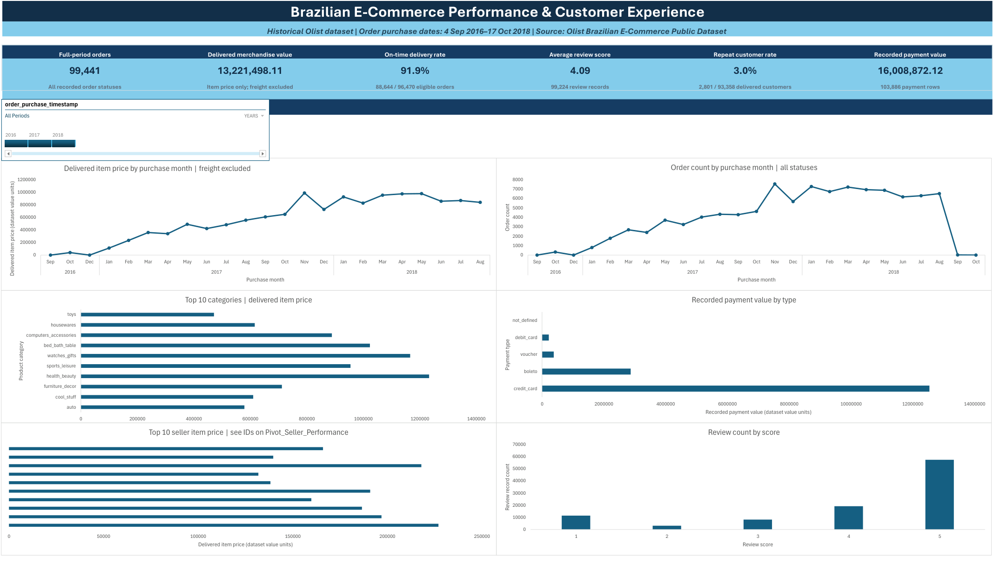

# Olist E-Commerce Analysis — Brazilian Marketplace 2016–2018

A descriptive analysis of the Olist Brazilian E-Commerce Public Dataset, built in Excel with Power Query and the Data Model. Nine related CSVs, each kept at its own record grain, feeding an executive dashboard.

| | |
|---|---|
| **Data** | 99,441 orders · 112,650 order items · 1,000,163 geolocation rows |
| **Period** | 4 September 2016 – 17 October 2018 |
| **Source** | [Kaggle — Brazilian E-Commerce Public Dataset by Olist](https://www.kaggle.com/datasets/olistbr/brazilian-ecommerce) |
| **Tools** | Power Query, Excel Data Model (6 relationships), join-check queries, PivotTables, PivotCharts |

> This is a historical analysis of recorded transactions. It does not describe present-day market conditions.

---

## Verified measures

| Measure | Result | Scope note |
|---------|--------|------------|
| Orders | 99,441 | All recorded order statuses |
| Delivered item price | 13,221,498.11 | Delivered item rows; freight excluded |
| On-time delivery | 91.9% | 88,644 of 96,470 eligible delivered orders |
| Average review | 4.09 / 5 | 99,224 review records |
| Repeat-customer share | 3.0% | 2,801 of 93,358 delivered customers |

Amounts are shown in the value units recorded in the source fields. The report does not label them as audited revenue or profit.

---

## Files

| File | Purpose |
|------|---------|
| `project details/Olist_Ecommerce_Project_Documentation.docx` | Full written report — method, data model, findings, sources |
| `project details/Olist_Ecommerce_Project_Presentation_Final.pptx` | 13-slide presentation of the project |
| `olist_*.csv` | The nine source datasets |
| `product_category_name_translation.csv` | Portuguese → English category lookup (71 rows) |
| `dashboard.png` | Screenshot of the executive dashboard |

### Source datasets

| File | Rows | Grain |
|------|------|-------|
| `olist_orders_dataset.csv` | 99,441 | One row per order; status and lifecycle timestamps |
| `olist_order_items_dataset.csv` | 112,650 | One row per item line in an order |
| `olist_customers_dataset.csv` | 99,441 | Per-order customer location, includes `customer_unique_id` |
| `olist_order_payments_dataset.csv` | 103,886 | One payment record/sequence — an order can have several |
| `olist_order_reviews_dataset.csv` | 99,224 | Review records and scores |
| `olist_products_dataset.csv` | 32,951 | One row per product |
| `olist_sellers_dataset.csv` | 3,095 | One row per seller |
| `olist_geolocation_dataset.csv` | 1,000,163 | Postal-prefix coordinates; not used for dashboard KPIs |
| `product_category_name_translation.csv` | 71 | Category lookup |

---

## Data model and record grain

The central design decision: keep orders, items, payments, reviews, customers, products, sellers and categories separate wherever their row counts differ. A one-to-many join applied carelessly multiplies item price and order counts, so the workbook builds six relationships on unique lookup keys and verifies each join separately.

| Entity | Key or counting rule | Why it matters |
|--------|---------------------|----------------|
| Orders | `order_id` | One order; use distinct `order_id` for order counts |
| Order items | `order_id` + `order_item_id` | One order line; item price sums at this grain |
| Payments | `order_id` + `payment_sequential` | Multiple payment rows can belong to one order |
| Reviews | `review_id` | Not assumed one per order |
| Customers | `customer_id` (per order) / `customer_unique_id` (per person) | Repeat-purchase analysis needs `customer_unique_id` |

The workbook contains **six active Data Model relationships** and dedicated join-check queries (`Check_OrderCustomerJoin`, `Check_ItemOrderJoin`, `Check_ItemProductJoin`, `Check_ItemSellerJoin`, `Check_ProductCategoryJoin`, `Check_PaymentOrderJoin`, `Check_ReviewOrderJoin`, `Check_ItemKeyUniqueness`, `Check_DeliveryResults`) so a broken or ambiguous relationship surfaces before it reaches a KPI.

---

## Workbook structure (32 sheets)

| Group | Sheets |
|-------|--------|
| Documentation | `Source Inventory`, `Project Notes` |
| Staging | `Clean_Orders`, `Clean_OrderItems`, `Clean_customers`, `Clean_Payments`, `Clean_Reviews`, `Clean_Products`, `Clean_Sellers`, `Clean_CategoryTranslation`, `Clean_ProductCategories`, `Clean_Delivery` |
| Join checks | `Check_OrderCustomerJoin`, `Check_ItemOrderJoin`, `Check_ItemProductJoin`, `Check_ItemSellerJoin`, `Check_ProductCategoryJoin`, `Check_PaymentOrderJoin`, `Check_ReviewOrderJoin`, `Check_ItemKeyUniqueness`, `Check_DeliveryResults` |
| Analysis | `Pivot_Order_Count`, `Pivot_Monthly_Orders`, `Pivot_Monthly_Value`, `Pivot_Category_Performance`, `Pivot_Seller_Performance`, `Pivot_Payment_Method`, `Pivot_Reviews_Score` |
| Output | `Executive Dashboard` |

---

## Business questions

1. How did monthly order volume and delivered item price change over the recorded period?
2. Which translated product categories and sellers had the highest delivered item price, and which categories had the most item rows?
3. How were recorded payment values distributed across payment types?
4. What share of eligible delivered orders arrived on or before the estimated delivery date?
5. How were review scores distributed, and what share of delivered customers placed at least two distinct delivered orders?

---

## Findings

- **On-time delivery is high but not universal.** 88,644 of 96,470 eligible delivered orders arrived on or before the estimated date — 91.9%. The remaining 8.1% is the customer-experience risk area.
- **Reviews skew positive.** Average score 4.09 out of 5 across 99,224 records.
- **Repeat purchasing is very low.** Only 3.0% of delivered customers placed two or more distinct delivered orders, using `customer_unique_id` as the person-level key. This is the single most striking finding: the marketplace acquires customers but rarely retains them.
- **Grain matters more than totals.** Payment value sums from payment rows and order counts from distinct orders — reporting them as if they shared a grain would overstate both.

---

## Note on the analysis workbook

`Olist_Ecommerce_Analysis.xlsx` is **not included in this repository**. At ~107 MB it exceeds GitHub's hard 100 MB per-file limit. Nothing is lost — it is fully rebuildable from the CSVs in this folder.

### Rebuilding it

1. Open a blank workbook in Excel for Microsoft 365.
2. **Data → Get Data → From Text/CSV** and load each of the nine `olist_*.csv` files plus `product_category_name_translation.csv`. Choose **Transform Data** rather than Load, so each query lands in Power Query first.
3. In Power Query, set the correct data types per column — especially the timestamp columns in `orders` (`order_purchase_timestamp`, `order_approved_at`, `order_delivered_carrier_date`, `order_delivered_customer_date`, `order_estimated_delivery_date`) and the numeric columns in `order_items` (`price`, `freight_value`).
4. Rename the output queries to match the `Clean_*` sheets and **Close & Load To… → Only Create Connection**, then tick **Add to Data Model**.
5. Open **Power Pivot → Manage** and create the six relationships on the keys listed in the data-model table above.
6. Build the PivotTables and PivotCharts named `Pivot_*` on their own sheets, then assemble `Executive Dashboard`.
7. To reproduce the delivery and repeat-customer measures, add a delivery flag (`order_delivered_customer_date <= order_estimated_delivery_date`) and a distinct-order count per `customer_unique_id`, then filter to delivered status.

The `project details/` folder documents the exact measures, scope notes and results, so the rebuilt workbook can be checked against the published figures.

---

## Data-quality notes

From `notes.txt` in the repository root, profiling the source files:

- `order_approved_at` — under 1% empty
- `order_delivered_carrier_date` — about 2% empty
- `order_delivered_customer_date` — about 3% empty

Those blanks are expected: cancelled and undelivered orders never receive the later lifecycle timestamps. Delivery and on-time measures are therefore calculated only over orders that actually have a delivery timestamp, which is why the denominator is 96,470 rather than 99,441.
