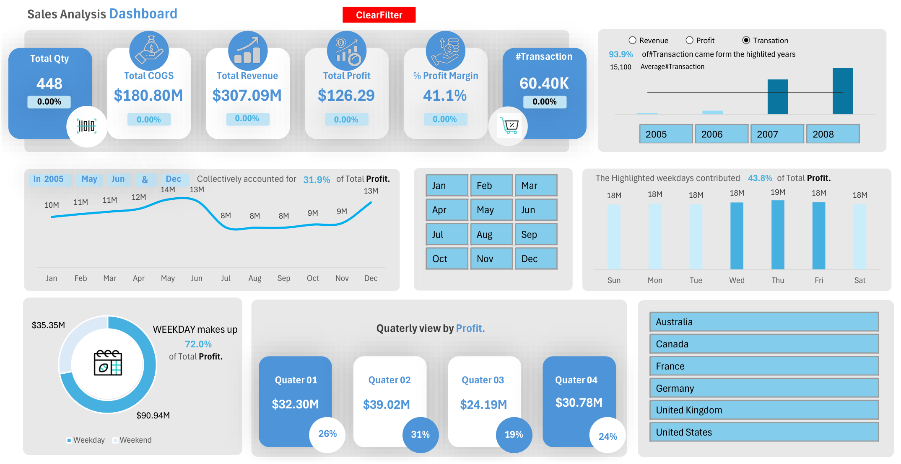

# Project 2 — AdventureWorks Time Series Dashboard

A macro-enabled Excel workbook that puts a star-schema Data Model behind a single time-series dashboard, so revenue, cost and margin can be sliced by country, month and year in one click.

| | |
|---|---|
| **Data** | AdventureWorks sample database — 60,399 internet sales rows |
| **Tools** | Excel Data Model (Power Pivot), measures, time intelligence (YoY), slicers, macros (`.xlsm`) |

---

## Files

| File | Purpose |
|------|---------|
| `EXCEL WORK/Dashboard.xlsm` | The finished dashboard — macro-enabled |
| `Databases/AdventureWorks.xlsx` | Flattened source tables (fact + dimensions) |
| `Images/` | Icons and graphics used on the dashboard |
| `dashboard.png` | Screenshot of the finished dashboard |

---

## Data model

A star schema with one fact table and five dimensions.

| Table | Rows | Role |
|-------|------|------|
| `FactInternetSales` | 60,399 | Fact — one row per sales line |
| `DimCustomer` | 18,485 | Customer attributes |
| `DimProduct` | 607 | Product hierarchy |
| `DimDate` | 2,192 | Calendar table, drives all time intelligence |
| `DimGeography` | 656 | City / state / country |
| `DimSalesTerritory` | 12 | Sales territory grouping |

Keeping `DimDate` as a separate, contiguous calendar table is what makes the year-over-year and time-series measures reliable — a date column taken straight from the fact table would leave gaps and break the comparison.

---

## Workbook structure

| Sheet | Role |
|-------|------|
| `Time Series Dashboard` | The dashboard: KPI cards, trend charts, slicers |
| `Analysis 1`, `Analysis 1 (2)` | Supporting analysis views |
| `LookTable` | Helper lookups for month and day names |
| `All Measures` | Central list of every measure used on the dashboard |
| `FactInternetSales`, `Dim*` | Source tables loaded into the Data Model |

---

## Measures

| Measure | What it reports |
|---------|-----------------|
| Total Revenue | Sum of sales amount |
| COGS | Cost of goods sold |
| Total Profit | Revenue − COGS |
| % Profit Margin | Profit ÷ Revenue |
| Total QTY | Units sold |
| Total Transaction | Distinct transaction count |
| YoY Change | Current year vs previous year, per measure |

---

## Dashboard features

- **Slicers:** Country · Month Name · Year — all charts respond together.
- **One-click year comparison:** an option-button selector drives current-year vs previous-year figures, with the selected year, previous year, profit and YoY change shown side by side.
- **Product status tracking:** All Products / Sold Products / Unsold Products, plus an above-average percentage view.
- **KPI cards:** Transaction count, sold products, profit margin, COGS, revenue, profit and order quantity.

---

## Note on the file format

The dashboard uses macros, so it is saved as `.xlsm` rather than `.xlsx`. If Windows blocks it after download, right-click the file → **Properties** → tick **Unblock** → **Apply**, then open it and click **Enable Content** when Excel asks.

---

## Reproducing it

1. Open `EXCEL WORK/Dashboard.xlsm` in desktop Excel.
2. Click **Enable Content** to allow the macros.
3. Use the slicers and the year selector on the `Time Series Dashboard` sheet.
4. The Data Model loads from `Databases/AdventureWorks.xlsx` — use **Data → Refresh All** after changing the source.
