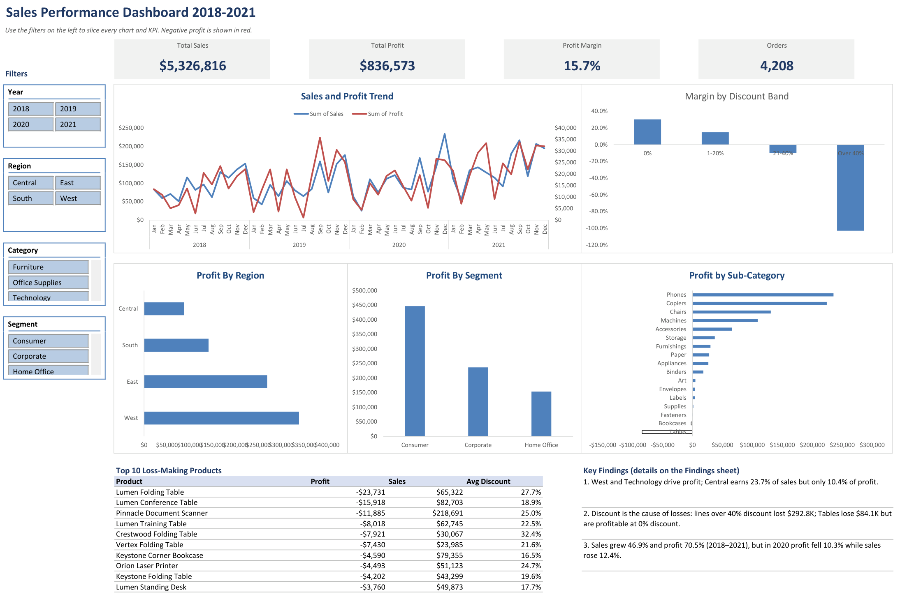

# Excel Data Analytics Portfolio

Two end-to-end Excel analytics projects covering data preparation, data-quality validation, PivotTables, the Excel Data Model, and interactive dashboards.

**Author:** Rojan Chandra Poudel

Each project starts from raw data, documents its quality checks, and ends in a dashboard that answers a specific business question. Where the source data is public, the original files are included so the analysis can be reproduced.

---

## Projects at a glance

| # | Project | Domain | Records | Headline result | Tools |
|---|---------|--------|---------|-----------------|-------|
| 1 | [Sales Performance Dashboard](PROJECT_1/) | US retail 2018–2021 | 8,888 order lines | 15.70% margin on $5.33M sales; discounting is the main loss driver | Excel Tables, PivotTables, PivotCharts, slicers |
| 2 | [AdventureWorks Time Series Dashboard](PROJECT_2/) | AdventureWorks reseller | 60,399 sales rows | Year-over-year revenue, COGS and margin with one-click slicers | Data Model (Power Pivot), DAX-style measures, macros |

---

## Dashboard previews

### Sales Performance Dashboard — `PROJECT_1/`



### AdventureWorks Time Series Dashboard — `PROJECT_2/`


---

## What each project demonstrates

### 1. Sales Performance Dashboard (`PROJECT_1/`)

A four-year retail sales workbook built to answer three questions: what drives profit, which products lose money, and how the trend moved.

**Headline figures**

| Measure | Value |
|---------|-------|
| Total sales | $5,326,816.11 |
| Total profit | $836,572.94 |
| Profit margin | 15.70% |
| Orders | 4,208 |

**Key findings**

- **West and Technology drive profit.** West earns 40.5% of total profit from 32.3% of sales (19.7% margin). Technology earns 75.9% of profit from 50.1% of sales (23.8% margin).
- **Central is the weak spot.** It generates 23.7% of sales but only 10.4% of profit.
- **Discount is the cause of the losses.** Lines discounted above 40% lost $292.8K. Tables lose $84.1K overall, yet are profitable at 0% discount.
- **Growth was strong but 2020 broke the pattern.** Sales grew 46.9% and profit 70.5% across 2018–2021, but in 2020 sales rose 12.4% while profit fell 10.3%.

### 2. AdventureWorks Time Series Dashboard (`PROJECT_2/`)

A macro-enabled workbook that puts a star-schema Data Model behind a single time-series dashboard.

- **Fact table:** `FactInternetSales` — 60,399 rows
- **Dimensions:** `DimProduct` (607), `DimCustomer` (18,485), `DimDate` (2,192), `DimGeography` (656), `DimSalesTerritory` (12)
- **Measures:** Total Revenue, COGS, Total Profit, % Profit Margin, Total QTY, Transactions, YoY Change
- **Filters:** country, month name and year slicers; one-click year selection drives current-year vs previous-year comparison

> The dashboard lives in a `.xlsm` file because it uses macros. If Windows blocks it after download, right-click the file → **Properties** → tick **Unblock**.

---

## Repository layout

```
.
├── README.md                  <- you are here
├── notes.txt                  <- working data-profiling notes
├── PROJECT_1/                 <- Sales Performance Dashboard 2018–2021
│   ├── README.md
│   ├── dashboard.png
│   ├── Sales_Dashboard_Project.xlsx
│   └── Sales_Data_2018_2021.xlsx
└── PROJECT_2/                 <- AdventureWorks Time Series Dashboard
    ├── README.md
    ├── dashboard.png
    ├── EXCEL WORK/Dashboard.xlsm
    ├── Databases/AdventureWorks.xlsx
    └── Images/
```

---

## Data sources

| Dataset | Source | Licence note |
|---------|--------|--------------|
| AdventureWorks | Microsoft sample database | Sample data |
| Sales 2018–2021 | Sample / synthetic | Illustrative only |

Findings describe the recorded data in each dataset and are not statements about current market conditions.

---

## Opening the workbooks

1. Clone the repository.
2. Open the `.xlsx` / `.xlsm` files in desktop Excel (Microsoft 365 recommended).
3. Enable editing if Excel opens in Protected View — slicers and macros need it.
4. To refresh a dashboard, use **Data → Refresh All**.
